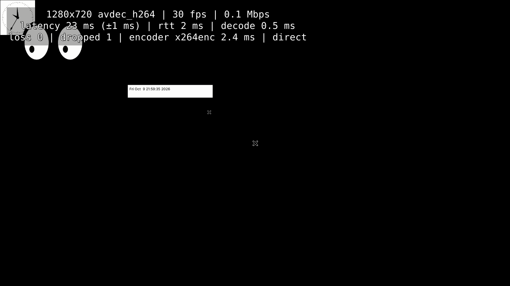

# Mist Remote Play

Open-source remote game streaming between Windows and Linux PCs: a **host**
captures its screen, system audio and accepts authorized keyboard, mouse and
controller input; a **client** shows the live stream in a low-latency window
and forwards input. Sessions are encrypted WebRTC (DTLS-SRTP), negotiated
through a small signaling server, peer-to-peer when possible and relayed
through TURN when not.

Mist is an original implementation. It is inspired by products such as
Steam Remote Play and Moonlight but shares no code, assets or protocols
with them.



## Status

What has actually been run and verified is listed in
[docs/compatibility.md](docs/compatibility.md) and measured in
[docs/benchmarks.md](docs/benchmarks.md). Summary:

| Area | State |
|---|---|
| Linux host (X11) → Linux client | **Working, tested** (separate processes and separate network namespaces; real X11 capture, PulseAudio system audio, XTest input) |
| 1080p60 software H.264 (x264) | **Measured**: 60 fps, ~15 ms from screen grab to the client (Low latency preset, loopback, mean of 3 runs), with a per-stage breakdown in every stats event |
| Latency tuning | Low latency preset (default), stats overlay out of the video path while hidden, NACK retransmission of lost packets (5 % loss: ~28 ms), GPU window renderer on X11 (falls back to software when OpenGL is slow) — see [docs/benchmarks.md](docs/benchmarks.md) |
| Controllers | Client → host controller input and host → client **rumble** **tested across processes** (scripted controller + mock virtual pad, also in CI); virtual pads via uinput / ViGEmBus and physical pads via gilrs are implemented but not run (no hardware in the test VM) |
| Pairing, consent, signed signaling, TLS | **Working, tested** (unit, integration and end-to-end) |
| Internet path: STUN/TURN (UDP, TCP), forced relay, blocked UDP | **Working, tested** with coturn in network namespaces |
| Network interruption recovery (10–25 s outages) | **Working, tested** |
| Adaptive bitrate under loss | **Working, tested** (iptables-induced loss) |
| Desktop app (Tauri 2 + React) | **Working, tested** under Xvfb with two app instances |
| Windows host/client | **Installer built and smoke-tested on GitHub's Windows runners** (installed copy finds its codecs and streams a test pattern end to end); real capture, audio and input not yet run on a physical Windows PC |
| No separate server needed | Hosts run the signaling server themselves (TLS, fingerprint pinned on first use); **tested** across network namespaces |
| Wayland capture (portal/PipeWire), uinput input & virtual gamepads | **Implemented, not run** (no Wayland compositor or `/dev/uinput` in the test VM) |
| Hardware encoders (NVENC, VA-API, QSV, AMF, Media Foundation) | **Implemented with runtime probing, not run** (no GPU in the test VM) |

## Install (Windows, no compiling)

Download the installer from the latest **Windows installer** run under
**Actions** (or **Releases**), install it on both PCs, start hosting on one
and pair from the other. Step-by-step: **[docs/install-windows.md](docs/install-windows.md)**.
The host runs Mist's server itself, so nothing else needs to be set up for
the same network; over the internet, forward one TCP port on the host's router.
From 0.1.1 on, the app updates itself (Settings → Updates; needs a read-only
GitHub token once because the repository is private).

## Quick start (Linux, from source)

```bash
# 1. System packages (Ubuntu 24.04 / Debian 12+). See docs/linux-setup.md for others.
sudo apt install build-essential pkg-config libssl-dev \
  libgstreamer1.0-dev libgstreamer-plugins-base1.0-dev libgstreamer-plugins-bad1.0-dev \
  gstreamer1.0-plugins-{base,good,bad,ugly} gstreamer1.0-libav gstreamer1.0-nice \
  gstreamer1.0-pulseaudio gstreamer1.0-x gstreamer1.0-pipewire gstreamer1.0-gl libudev-dev \
  libwebkit2gtk-4.1-dev libayatana-appindicator3-dev librsvg2-dev   # last line: desktop app only
# Rust (stable) from https://rustup.rs and Node.js 20+ for the desktop app.

# 2. Build the core, CLI and signaling server
cargo build --release

# 3. Run a signaling server (local test; see docs/networking.md for production TLS + TURN)
MIST_SIGNAL_BIND=127.0.0.1:8443 ./target/release/mist-signaling-server

# 4. On the host PC
./target/release/mist --signaling ws://127.0.0.1:8443 host --pair
#    -> prints a pairing code; type `y` to approve requests

# 5. On the client PC
./target/release/mist --signaling ws://127.0.0.1:8443 pair ABCD-EFGH
./target/release/mist connect            # opens the streaming window
```

Across machines the signaling URL must be `wss://` (the client refuses
unencrypted signaling except to `localhost`). `mist --help` lists all commands;
`mist diagnose` prints what this machine can capture, encode and inject.

### Desktop app

```bash
cd apps/desktop
npm install
cargo build --release -p mist-app-core          # the app launches the `mist` CLI for streaming windows
MIST_CLI_PATH=../../target/release/mist npm run tauri dev
# Packages (.deb/.AppImage on Linux, .msi/.exe on Windows):
scripts/prepare-sidecar.sh && npm run tauri build
```

## Streaming window shortcuts

`Ctrl+Alt+Shift` plus: **Q** disconnect · **F** fullscreen · **M** capture/release
mouse · **S** statistics overlay · **A** mute.

## Repository layout

```
apps/desktop/            Tauri 2 shell (src-tauri) + React/TypeScript/Tailwind UI (src)
crates/protocol          Versioned wire types, identities, pairing proofs, validation
crates/capture-api       CaptureBackend trait; X11, Wayland portal, Windows DXGI, test pattern
crates/audio-api         AudioCaptureBackend trait and types
crates/media-engine      The only GStreamer user: encoders/decoders, host/client WebRTC pipelines
crates/input-api         InputBackend trait, validated dispatcher; XTest, uinput, SendInput
crates/controller-api    Controller normalization/mapping, gilrs discovery, uinput/ViGEm pads
crates/session-manager   Pairing codes, trust store, session state machine, reconnect, bitrate
crates/signaling-client  Authenticated WebSocket/TLS client
crates/app-core          Host service, client session, window renderer, `mist` CLI
crates/diagnostics       Logging setup and in-memory log buffer
services/signaling-server  Signaling service (axum)
deploy/                  coturn, Caddy, Docker Compose, systemd, udev examples
tests/                   In-process integration tests and the end-to-end harness
docs/                    Architecture, security, networking, setup, troubleshooting, results
```

## Documentation

* [Architecture](docs/architecture.md)
* [Security model](docs/security.md)
* [Networking, signaling and TURN deployment](docs/networking.md)
* [Linux setup](docs/linux-setup.md) · [Windows setup](docs/windows-setup.md)
* [Troubleshooting](docs/troubleshooting.md)
* [Testing](docs/testing.md) · [Benchmarks](docs/benchmarks.md) · [Compatibility matrix](docs/compatibility.md)
* [Licensing and codecs](docs/licensing.md)
* [Task tracker](TASKS.md)

## License

MIT OR Apache-2.0, at your option. Note that some GStreamer plugins used at
runtime (e.g. x264) are GPL and H.264 may be patent-encumbered in some
jurisdictions; see [docs/licensing.md](docs/licensing.md).
